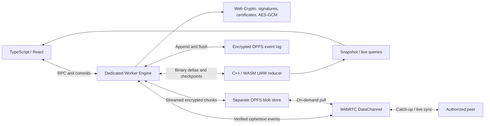

# Sovereign Local Core

**A Zero-Server, Local-First P2P Database for the Web.**

Put the database inside your application. Sovereign Local Core stores signed,
encrypted events in the browser, materializes them with a C++/WebAssembly CRDT,
and exchanges updates directly between authorized peers over WebRTC. Your app
keeps working offline, recovers its local state after a reload, and shares large
files through encrypted streams instead of putting file bytes in the database log.

[Quick start](#quick-start) · [Examples](examples/README.md) · [Architecture](#architecture)
· [Benchmarks](docs/WASM_BENCHMARKS.md) · [Contributing](CONTRIBUTING.md) · [MIT license](LICENSE)

**Status: experimental, version 0.1.0.** This is a working, tested database core,
not a drop-in Supabase replacement or an independently audited security product.
"Zero-server" means no database or authentication server is required for local
operation. Online peer discovery uses a signaling relay; internet connectivity
may also need STUN/TURN. You control that infrastructure.

## Features

- **No hosted database bill.** Data lives on participating devices; local reads
  and writes work without a database backend or paid cloud storage service.
- **C++20 / WASM materialization.** A persistent native reducer runs in a Dedicated
  Worker, applies binary deltas and preserves hidden registers and tombstones.
- **Offline-first OPFS.** Append-only events, explicit flushes and encrypted
  checkpoints support local recovery without waiting for a peer.
- **Deterministic CRDT views.** Per-field last-writer-wins registers converge for
  the same authorized event set using Lamport clocks and public-key ActorIDs.
- **Signed identities and E2EE.** Web Crypto protects local identity vaults,
  signs events and encrypts project fields with AES-GCM. Admin-signed certificates
  control membership; revocation rotates project keys.
- **Direct P2P sync.** WebRTC DataChannels provide catch-up, live events,
  reconnection, fragmentation and bounded backpressure.
- **Encrypted file streams.** Fixed-size chunks stay outside the CRDT log.
  SHA-256 and AES-GCM verify lazy pulls; only file metadata synchronizes eagerly.
- **Optional React hooks.** `useProject`, `useLiveQuery` and `useStorage` handle
  lifecycle, selected views, progress and cancellation. The browser core has no
  runtime NPM dependencies; React is an optional peer.

## Quick start

Use a browser with OPFS synchronous access in Workers, Web Crypto and WASM exception
support, on **HTTPS or localhost**. Installed packages include the Worker and WASM;
applications do not need a C++ compiler. Chrome is the browser tested in this repo.

Install the GitHub release artifact today:

```sh
npm install https://github.com/5645hm-a11y/sovereign-local-core/releases/download/v0.1.0/sovereign-local-core-0.1.0.tgz
```

The intended NPM name is `sovereign-local-core`; registry publication is pending.
After an NPM release, installation will be `npm install sovereign-local-core`.
To build and install from source instead, see [Contributing](CONTRIBUTING.md).

### Vanilla TypeScript

Supply credentials from your UI and retain the random project ID to reopen it.
`createProject` initializes a new Admin root; a member needs an Admin-signed invitation.

```ts
import { LocalCoreClient } from 'sovereign-local-core';

export async function openTasks(email: string, password: string, projectId: string) {
  const db = new LocalCoreClient();
  const credentials = { email, password, projectId }; // Password: at least 12 characters.
  try {
    try { await db.open(projectId, credentials); }
    catch (error) {
      if (!(error instanceof Error) || error.name !== 'ProjectNotInitializedError') throw error;
      await db.createProject(projectId, credentials);
    }
  } catch (error) { await db.close().catch(() => {}); throw error; }

  await db.dispatch({
    type: 'ITEM_ADDED', itemId: `task_${crypto.randomUUID()}`,
    fields: { kind: 'task', title: 'Ship something local-first', done: false },
  }); // Resolves after the event is flushed.

  const tasks = (await db.snapshot()).items.filter(item => item.fields.kind === 'task');
  console.log(tasks);
  const unsubscribe = db.onCommit(() => void db.snapshot().then(console.log));
  return { db, dispose: async () => { unsubscribe(); await db.close(); } };
}
```

Call `dispose()` when your app is done with the client. Reopening with the same
origin, credentials and project ID restores the encrypted local log and view.
Complete add/update/delete UI: [Vanilla To-Do](examples/vanilla-todo/src/main.ts).

### React

Install React in your application, then import the separate React entry point.
In Next.js App Router, keep this component behind a `"use client"` boundary.

```tsx
'use client';
import { useProject, ProjectProvider, useLiveQuery } from 'sovereign-local-core/react';
import type { LocalCoreClient } from 'sovereign-local-core';

export function Project({ email, password, projectId }: { email: string; password: string; projectId: string }) {
  const project = useProject(projectId, { email, password, createIfMissing: true });
  if (project.status === 'error') return <p>{project.error?.message}</p>;
  if (project.status !== 'ready' || !project.client) return <p>Opening local database…</p>;
  return <ProjectProvider project={project}><Tasks client={project.client}/></ProjectProvider>;
}

function Tasks({ client }: { client: LocalCoreClient }) {
  const { data: tasks = [] } = useLiveQuery(
    view => view.items.filter(item => item.fields.kind === 'task')
  ); // Pure projection; unrelated CRDT changes retain the selected result.
  async function add() {
    await client.dispatch({ type: 'ITEM_ADDED', itemId: `task_${crypto.randomUUID()}`,
      fields: { kind: 'task', title: 'My first task', done: false } });
  }
  return <>
    <button onClick={() => void add().catch(console.error)}>Add task</button>
    <ul>{tasks.map(task => <li key={task.id}>{task.fields.title}</li>)}</ul>
  </>;
}
```

One `useProject` owns the client; share it through the provider. Actual unmount
closes the Worker and P2P connections; Strict Mode effect replay is supported.
See [the complete React To-Do + files example](examples/react-demo/src/App.jsx)
and [DX guide](docs/DX.md) for explicit handles, equality, CSP and asset options.

### Stream files

```ts
const { manifest } = await db.storage.upload(file, {
  onProgress: p => console.log(p.completedChunks, p.totalChunks),
}); // File or Blob; defaults to encrypted 1 MiB chunks.

// Large files: consume a stream instead of assembling the entire file in RAM.
await db.storage.pipeTo(manifest.fileId, destinationWritable);
```

An encrypted/signed `FILE_ADDED` event is committed only after every chunk is
durably stored. Register a connected transport with `db.storage.addPeer(sync)` to
pull missing chunks. `readBlob` is capped at 16 MiB; `readStream`/`pipeTo` handle
larger files within current limits of 1 GiB and 1,024 chunks. Progress during upload
counts durable local preparation; peers pull files later. [Storage contract](docs/STORAGE.md).

## Architecture



The network transports bytes; the Worker verifies signatures, project membership
and AES-GCM integrity before accepting events. Only flushed events are acknowledged
and published. The native reducer materializes authorized binary commands; it does
not make trust decisions. Checkpoints restore native state and replay the tail.
The signaling relay routes SDP/ICE only and never handles database or file content.

[Core contracts](docs/CORE.md) · [Identity](docs/IDENTITY.md)
· [RBAC and encryption](docs/CRYPTO_RBAC.md) · [P2P](docs/P2P.md) · [Native ABI](docs/WASM.md)

## Measured, not promised

In the recorded encrypted OPFS workload of **1,006 events**, checkpoint recovery
had a median of **389.6 ms**, compared with **4,765.5 ms** for full replay. A separate
300,000-event projection experiment measured a **13.2 ms native kernel**; that
excludes cryptography, disk and the bridge. Results depend on hardware and workload.
Full context, raw data and reproduction commands: [Benchmarks](docs/WASM_BENCHMARKS.md).

## Scope and limits

This version supports **two peers per signaling room**, scalar-field LWW records
and project-level permissions. It does not implement SQL, text CRDTs, distributed
transactions, consensus or guaranteed availability. Missing chunks require an
online authorized provider. Browser storage has quotas and can be deleted or evicted.
Credentials unlock a random-key vault; credentials alone cannot recreate a deleted
vault. Revocation cannot erase plaintext or old keys already held by a recipient.
Metadata remains visible, and malicious clocks/withheld history are not fully solved.
See [security boundaries](SECURITY.md) and the detailed contracts before deployment.

## Develop and contribute

```sh
npm ci
npm test               # C++/WASM build + unit suite
npm run test:browser   # OPFS, recovery, identity, RBAC and real WebRTC
npm run test:dx        # Installed-package Vite/Next/React integration
```

Development needs Node.js 24, Python 3 and Emscripten; activate the SDK first.
Browser tests use installed Google Chrome. Build and contribution instructions:
[CONTRIBUTING.md](CONTRIBUTING.md). Try the [public examples](examples/README.md).

Licensed under the [MIT License](LICENSE). Contributions are welcome.
