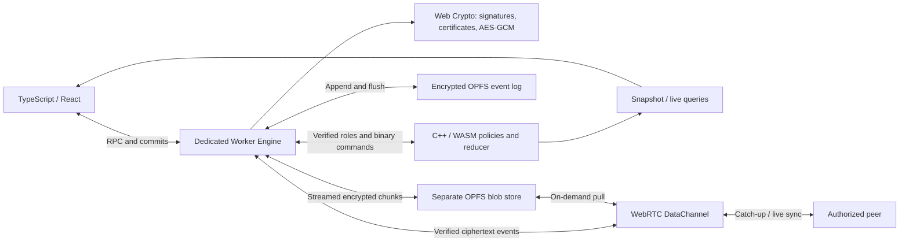

# Sovereign Local Core

**A Zero-Server, Local-First P2P Database Engine for the Web.**

Put the database inside your application. Sovereign Local Core stores signed,
encrypted events in the browser, materializes them with a C++/WebAssembly CRDT,
and exchanges updates directly between authorized peers over WebRTC. Your app
keeps working offline, recovers its local state after a reload, and shares large
files through encrypted streams instead of putting file bytes in the database log.

[Quick start](#quick-start) · [Examples](examples/README.md) · [Architecture](#architecture)
· [Benchmarks](docs/WASM_BENCHMARKS.md) · [Contributing](CONTRIBUTING.md) · [MIT license](LICENSE)

**Status: experimental, version 0.3.1.** This is a working, tested database core,
not a drop-in Supabase replacement or an independently audited security product.
"Zero-server" means no database or authentication server is required for local
operation. Online peer discovery uses signaling relays; internet connectivity
may also need STUN/TURN. Public Nostr relays support encrypted peer
discovery, removing the need to operate your own signaling server.

**Evaluating it for an existing app?** Start with the [two-device walkthrough](docs/ADOPTION.md)
and [browser/mobile evidence](docs/BROWSER_SUPPORT.md). The public TypeScript example
now includes wallet pairing, root-pinned invitations, live WebRTC sync, paused
offline edits and recovery after reload. Google Sign-In is a separate integration;
wallets are not Google accounts. [Independent security review status and scope](docs/SECURITY_REVIEW.md).

[Open the public two-device SDK example](https://5645hm-a11y.github.io/sovereign-local-core/sync.html)
on both devices. Use synthetic data and test wallets. The example is an optional
static client; it is not a hosted database or authentication service.

**New in 0.3.0: query less, replay less, keep writes fast.** Native scalar
filters, ordered keyset pages and incremental indexes avoid rebuilding a field
index after ordinary edits. Compact startup/receipts and `usePagedQuery` avoid
whole-database views. Independently keyed read domains, affected-row invariant
replay and bounded P2P/discovery recovery extend the same engine across projects.
Sovereign wallets and signed write policies remain part of the core. This release
is a database SDK; applications choose their own schemas, interfaces and workflows.

## 100,000 rows. 0.15 ms indexed reads after an edit.

The recorded Node/WASM workload returns the **complete matching result** rather
than comparing an indexed page with a full database scan. On 100,000 rows, a
post-edit equality query returns 101 matching rows after maintaining two indexes.

| Operation on 100,000 rows | Median |
| --- | ---: |
| Indexed equality read immediately after an edit | **0.15 ms** |
| Edit plus maintenance of two cached indexes | **0.13 ms** |
| Initial index build plus equality read | 24.95 ms |
| Same original equality result through a complete bounded scan | 15.84 ms |

Measured on Intel Core i7-10700, Node 24.15.0 and Emscripten 6.0.11: one warm-up,
five samples. These include the native reducer/binary bridge and JS query decoding,
plus producer encoding for the edit. **They exclude OPFS, cryptography, Worker RPC,
network and startup**; they are not end-to-end browser response guarantees.
[Exact workload, raw samples and reproduction](docs/INCREMENTAL_INDEXES.md).

**The database core runs in a Dedicated Worker.** WASM materialization, validation,
OPFS synchronous I/O and native query work execute away from the UI thread.
Bounded pages and compact receipts limit data sent back to application code.
Rendering, main-thread callbacks, packaging startup and transport work can still
consume UI time; this release does not claim measured zero long tasks in every app.
Initial builds, large deltas and restore retain additional costs.

Version 0.3.0 adds [cryptographic read domains](docs/READ_DOMAINS.md): a general
namespace for arbitrary records/files over separately keyed projects, with signed
read grants and routing enforced by the core. These APIs are included in the v0.3.0 artifact. See [current scalability bounds](docs/SCALABILITY.md) before
sizing a project; unlimited user counts or histories are not established.

Version 0.3.0 sync also supports [paged actor frontiers](docs/SYNC_FRONTIERS.md):
bounded 128-actor pages, per-page backpressure and durable reconnect, tested with
10,000 synthetic actors/hints. [Bounded log cursors](docs/SYNC_CURSORS.md) now
feed catch-up directly from OPFS in 64-record / 128 KiB pages under durable ACK
backpressure. [Authenticated address indexes](docs/SYNC_INDEX.md) now skip known
frames for small deltas and restore from signed checkpoints. Index memory and
cold prefix verification still grow with history. [Bounded neighbor exploration](docs/SPARSE_OVERLAY.md)
now rotates eligible idle edges to reconnect previously separate components.
Opt-in [routed discovery](docs/DISCOVERY_ROUTING.md) samples presence buckets and
targets signaling to stable instance inboxes. A 10k synthetic presence model
records 99.60% fewer deliveries; it is not a 10k-user throughput test. Adaptive
layouts and guaranteed global connectedness remain work.

Version 0.3.0 [paged key epochs](docs/PAGED_EPOCHS.md) split large revocations into
root-signed, Merkle-verified key/witness pages. Cutover is crash-recoverable and
blocks new-epoch operations until all pages arrive. The synthetic 10k-record
fixture bounds the largest signed record to 81,434 bytes; whole-history memory,
invitation keyrings and cold discovery after rotation remain finite constraints.

Version 0.3.0 [discovery recovery](docs/DISCOVERY_RECOVERY.md) lets offline authorized
peers retrieve signed epoch controls from another current Member, with recipient
encryption and no data/SDP on the stable recovery channel. Normal discovery now
rebinds automatically. Opt-in [routed recovery](docs/RECOVERY_ROUTING.md) samples
probes and sends selected transfers between dedicated inboxes; unselected offers
allocate no cursor. Plain providers retain broadcast mode. Reachable current
replicas, matching layouts and further adaptive/rate work remain necessary.

## Features

- **No hosted database bill.** Data lives on participating devices; local reads
  and writes work without a database backend or paid cloud storage service.
- **C++20 / WASM materialization.** A persistent native reducer runs in a Dedicated
  Worker, applies binary deltas and preserves hidden registers and tombstones.
- **Offline-first OPFS.** Append-only events, explicit flushes and encrypted
  checkpoints support local recovery without waiting for a peer.
- **Deterministic CRDT views.** Per-field last-writer-wins registers converge for
  the same authorized event set using Lamport clocks and public-key ActorIDs.
- **Signed identities and E2EE.** Web Crypto protects local identity vaults,
  signs events and encrypts project fields with AES-GCM. Admin-signed certificates
  control membership; revocation rotates project keys.
- **Zero-server Auth via sovereign wallets.** Email-free
  wallets, Admin/Member/Kiosk certificate chains and root-signed row policies.
  A native checkout/return state machine converges with explicit conflict decisions.
- **Direct P2P sync.** WebRTC DataChannels provide catch-up, live events,
  reconnection, fragmentation and bounded backpressure.
- **Encrypted public discovery.** Optional Nostr relays
  carry signed, project-key-encrypted SDP/ICE with replay protection. Discovery,
  WebRTC and the reusable Streams sync protocol have separate interfaces.
  The new WebRTC wrapper connects multiple peers with independent per-edge retries.
- **Encrypted file streams.** Fixed-size chunks stay outside the CRDT log.
  SHA-256 and AES-GCM verify lazy pulls; only file metadata synchronizes eagerly.
- **Native indexed queries.** Scalar AND predicates, deterministic ordering,
  bounded pages and incremental caches run in C++/WASM. Small writes retain
  indexes; explicit resource limits keep builds and output accountable.
- **Cryptographic read domains.** Signed routing and independent project keys
  separate private records/files from shared data. Write policies remain native.
- **Optional React hooks.** `useProject`, `usePagedQuery`, `useLiveQuery` and `useStorage` handle
  lifecycle, selected views, progress and cancellation. The browser core has no
  runtime NPM dependencies; React is an optional peer. The separate Nostr adapter
  bundles a small secp256k1 dependency and its MIT notice.

## Quick start

Use a browser with OPFS synchronous access in Workers, Web Crypto and WASM exception
support, on **HTTPS or localhost**. Installed packages include the Worker and WASM;
applications do not need a C++ compiler. Chrome is the browser tested in this repo.

Install from the public NPM registry:

```sh
npm install sovereign-local-core
```

Version **0.3.1** is [published on NPM](https://www.npmjs.com/package/sovereign-local-core).
For a pinned installation, use `npm install sovereign-local-core@0.3.1`.
The registry tarball matches the tested GitHub release archive byte for byte;
[verification and build-attestation instructions](docs/PUBLISHING.md) explain the evidence.
The initial registry publication used local 2FA authorization and has no NPM
provenance attestation; the separate GitHub build attestation remains verifiable.
To build and install from source instead, see [Contributing](CONTRIBUTING.md).

### Vanilla TypeScript

Supply a local wallet ID and passphrase from your UI. Retain the random project
ID to reopen it. Creating a project makes a new Admin root; joining someone
else's project requires its pinned root and an Admin-signed invitation.

```ts
import { LocalCoreClient } from 'sovereign-local-core';

export async function openRecords(walletId: string, passphrase: string, projectId: string) {
  const db = new LocalCoreClient();
  const credentials = { mode: 'wallet' as const, walletId, passphrase, projectId };
  // Passphrase: at least 12 characters. Credentials unlock a random-key local vault.
  try {
    try { await db.openCompact(projectId, credentials); }
    catch (error) {
      if (!(error instanceof Error) || error.name !== 'ProjectNotInitializedError') throw error;
      await db.createProjectCompact(projectId, credentials);
    }
    await db.dispatchCommitted({
      type: 'ITEM_ADDED', itemId: `record_${crypto.randomUUID()}`,
      fields: { title: 'My first local record', status: 'open', priority: 1 },
    }); // Resolves after the signed encrypted event is flushed.

    const cursor = await db.openQueryCursor({
      kind: 'items', prefix: 'record_', limit: 32,
      where: [{ field: 'status', op: 'eq', value: 'open' }],
      orderBy: { field: 'priority', direction: 'desc' },
    });
    try { console.log((await db.readQueryCursor(cursor.id)).items); }
    finally { await db.closeQueryCursor(cursor.id); }
    return { db, dispose: () => db.close() };
  } catch (error) { await db.close().catch(() => {}); throw error; }
}
```

Call `dispose()` when your app is done with the client. Reopening with the same
origin, wallet, passphrase and project ID restores the encrypted local log and view.
The first bounded page is shown above; read until `page.done` for all results.
Legacy email/password vault selectors and full-Snapshot APIs remain supported.
Complete add/update/delete UI: [Vanilla To-Do](examples/vanilla-todo/src/main.ts).

### React

Install React in your application, then import the separate React entry point.
In Next.js App Router, keep this component behind a `"use client"` boundary.

```tsx
'use client';
import { useProject, usePagedQuery } from 'sovereign-local-core/react';

export function Records({ walletId, passphrase, projectId }: {
  walletId: string; passphrase: string; projectId: string;
}) {
  const project = useProject(projectId, {
    mode: 'wallet', walletId, passphrase, createIfMissing: true,
  });
  const query = usePagedQuery({
    kind: 'items', prefix: 'record_', limit: 32,
    where: [{ field: 'status', op: 'eq', value: 'open' }],
    orderBy: { field: 'priority', direction: 'desc' },
  }, { project });
  async function add() {
    await project.client?.dispatchCommitted({
      type: 'ITEM_ADDED', itemId: `record_${crypto.randomUUID()}`,
      fields: { title: 'My first record', status: 'open', priority: 1 },
    });
  }
  return <>
    {(project.error || query.error) && <p role="alert">{(project.error || query.error)?.message}</p>}
    <button disabled={project.status !== 'ready'} onClick={() => void add().catch(console.error)}>Add record</button>
    <ul>{query.page?.items.map(row => <li key={row.id}>{String(row.fields.title)}</li>)}</ul>
    <button disabled={!query.canNext} onClick={query.next}>Next page</button>
  </>;
}
```

One `useProject` owns the client; share it through the provider. Actual unmount
closes the Worker and P2P connections; Strict Mode effect replay is supported.
See [the complete React To-Do + files example](examples/react-demo/src/App.jsx)
and [DX guide](docs/DX.md) for explicit handles, equality, CSP and asset options.

### Stream files

```ts
const { manifest } = await db.storage.upload(file, {
  onProgress: p => console.log(p.completedChunks, p.totalChunks),
}); // File or Blob; defaults to encrypted 1 MiB chunks.

// Large files: consume a stream instead of assembling the entire file in RAM.
await db.storage.pipeTo(manifest.fileId, destinationWritable);
```

An encrypted/signed `FILE_ADDED` event is committed only after every chunk is
durably stored. Register a connected transport with `db.storage.addPeer(sync)` to
pull missing chunks. `readBlob` is capped at 16 MiB; `readStream`/`pipeTo` handle
larger files within current limits of 1 GiB and 1,024 chunks. Progress during upload
counts durable local preparation; peers pull files later. [Storage contract](docs/STORAGE.md).

### Global P2P through public discovery

Both clients must already have valid project membership. These APIs are included
in the 0.3.0 package above; no application-owned signaling server is required.

```ts
import { P2PWebRTC } from 'sovereign-local-core';
import { NostrDiscovery } from 'sovereign-local-core/nostr';

const sync = new P2PWebRTC(db, { discovery: new NostrDiscovery(), maxPeers: 8 });
const removePeer = db.storage.addPeer(sync);
try { await sync.start(); }
catch (error) { removePeer(); sync.stop(); throw error; }
// On disposal: removePeer(); sync.stop(); then await db.close().
```

This explicitly uses public Nostr relays and Google STUN. Configure `iceServers`
with your TURN service when direct connectivity fails. Relays cannot read the
encrypted SDP/ICE, but see their connecting clients' IP addresses and traffic
metadata. [Discovery contract, TURN configuration and tests](docs/DISCOVERY.md).

### Bounded reads and compact durable writes (v0.3.0)

The package includes `dispatchCommitted` and `ingestCommitted` receipts without full
Snapshot output, plus native query cursors for item-ID prefixes and decisions.
SyncSession selects compact ingestion automatically when the core supports it.

```ts
await db.dispatchCommitted({ type: 'ITEM_ADDED', itemId: 'record_1', fields: { title: 'Local' } });
const cursor = await db.openQueryCursor({ kind: 'items', prefix: 'record_', limit: 64, maxBytes: 32768 });
try {
  while (true) {
    const page = await db.readQueryCursor(cursor.id);
    consumeRows(page.items);
    if (page.done) break;
  }
} finally { await db.closeQueryCursor(cursor.id); }
```

New writes invalidate a cursor's revision; restart an incomplete consistent read.
A durable receipt is not final invariant acceptance. Existing Snapshot/React APIs
retain full-view behavior. [Contracts, scopes and measured Chrome latencies](docs/QUERY_PAGES.md).

React includes `usePagedQuery({ kind: 'items', prefix: 'record_', limit: 64 },
{ project })`: one retained page, selective commit refresh and safe first-page
restart after invalidation. React projects open compactly; a full view is requested
only by a legacy subscriber or explicit API. [Hook lifecycle and limits](docs/REACT_PAGED_QUERIES.md).

Field queries add `where: [{ field: 'status', op: 'eq', value: 'open' }]`
and `orderBy: { field: 'priority', direction: 'desc' }` to native cursors and
`usePagedQuery`. Two disposable indexes per session support typed equality/ranges;
small writes maintain cached indexes; initial builds, maintenance and post-write
reads are measured separately. Large deltas and restores still rebuild.
[Semantics, limits and benchmarks](docs/FIELD_QUERIES.md).

### Sovereign wallets and business policies

Wallets and policies are part of the core. A project root signs immutable rules;
the Worker verifies event signatures and certificate chains, then the native
reducer applies the authenticated role to the matching row policy.

```ts
import { LocalCoreClient, type ReducerPolicies } from 'sovereign-local-core';

const policies: ReducerPolicies = {
  version: 1, defaultAllow: false,
  rules: [{ prefix: 'record_', ownerField: null, library: false,
    create: ['Admin', 'Member'], update: ['Admin', 'Member'], delete: ['Admin'],
    checkout: [], return: [] }],
};
const db = new LocalCoreClient();
await db.createProjectCompact(replicaName, {
  mode: 'wallet', walletId, passphrase, projectId, policies,
}); // Parameters come from your application; no external Auth server.
await db.dispatchCommitted({ type: 'ITEM_ADDED', itemId: 'record_1', fields: { title: 'Protected record' } });
const { invitation } = await db.inviteMember(memberPublicKey, 'Member');
// Deliver this invitation through an authenticated channel. Members cannot delete record_ rows.
await db.close();
```

Signed unauthorized writes are rejected before append. Conditional invariants
retain conflict decisions in the durable log and recompute them when earlier
events arrive; offline acceptance is provisional. The built-in exclusive-resource
checkout/return reducer is a concrete invariant, not arbitrary smart-contract code.
See [policy and invariant contracts](docs/POLICIES.md). Write policies alone do
not hide rows from project key holders: use [independently keyed read domains](docs/READ_DOMAINS.md)
for private records/files.

## Architecture



The network transports bytes; the Worker verifies signatures, project membership
and AES-GCM integrity before accepting events. Only flushed events are acknowledged
and published. The Worker establishes cryptographic trust; the native reducer
enforces the pinned write policies and deterministic business predicates.
Checkpoints restore native state and replay the tail. Policy checkpoints also
retain conditional candidates so later events can change previous decisions.
Signaling carries SDP/ICE only and never database or file content. The new optional
discovery path encrypts and authenticates these messages inside the Worker.

[Core contracts](docs/CORE.md) · [Identity](docs/IDENTITY.md)
· [RBAC and encryption](docs/CRYPTO_RBAC.md) · [P2P](docs/P2P.md) · [Native ABI](docs/WASM.md)

## Recovery and replay measurements

In the recorded encrypted OPFS workload of **1,006 events**, checkpoint recovery
had a median of **389.6 ms**, compared with **4,765.5 ms** for full replay. A separate
300,000-event projection experiment measured a **13.2 ms native kernel**; that
excludes cryptography, disk and the bridge. Results depend on hardware and workload.
Full context, raw data and reproduction commands: [Benchmarks](docs/WASM_BENCHMARKS.md).

Business-policy replay uses a different path. Its [dedicated measurements](docs/INVARIANTS_BENCHMARKS.md)
include a v0.2.0 allocation failure near 100k candidates and the subsequent
immutable-candidate/duplicate optimization. Version 0.3.0 [affected-row replay](docs/ROW_REPLAY.md)
now reduces only new row suffixes or the affected row after a late arrival. At
99,998 retained candidates across 1,000 rows, Node WASM plus bridge tail apply
measured 204.06 ms before / 0.06 ms after; this excludes crypto, disk and query
delivery. A late event on one hot row still replays its full history. The
[release scope and remaining roadmap](docs/V0_3_ROADMAP.md) distinguishes shipped
read/query/sync improvements from future verified backups and other work; recovery and memory costs remain.

## Scope and limits

Version 0.3.0 supports scalar-field LWW records, sovereign wallets, project
membership, cryptographic read domains, native scalar queries/incremental indexes,
a bounded multi-peer mesh, row write policies and an exclusive-checkout view.
It does not implement SQL,
text CRDTs, arbitrary business contracts, distributed transactions, consensus
or guaranteed availability. Convergent offline checkout does not ensure physical
exclusivity or finality without coordination/escrow. Missing chunks require an
online authorized provider. Browser storage has quotas and can be deleted or evicted.
Credentials unlock a random-key vault; credentials alone cannot recreate a deleted
vault. Revocation cannot erase plaintext or old keys already held by a recipient.
Metadata remains visible, and malicious clocks/withheld history are not fully solved.
See [security boundaries](SECURITY.md) and the detailed contracts before deployment.

## Develop and contribute

```sh
npm ci
npm test               # C++/WASM build + unit suite
npm run test:browser   # OPFS, recovery, identity, RBAC and real WebRTC
npm run test:dx        # Installed-package Vite/Next/React integration
```

Development needs Node.js 24, Python 3 and Emscripten; activate the SDK first.
Browser tests use installed Google Chrome. Build and contribution instructions:
[CONTRIBUTING.md](CONTRIBUTING.md). Try the [public examples](examples/README.md).

Licensed under the [MIT License](LICENSE). Contributions are welcome.
