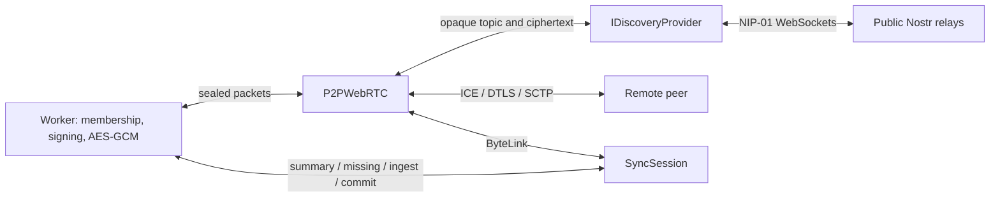

# Encrypted discovery and transport-independent synchronization

These APIs ship in version 0.2.0. Install its GitHub release artifact using the
[README](../README.md), or build using [the contribution instructions](../CONTRIBUTING.md).

## Connect authorized project members

```ts
import { P2PWebRTC, GOOGLE_STUN_SERVERS } from 'sovereign-local-core';
import { NostrDiscovery } from 'sovereign-local-core/nostr';
import type { LocalCoreClient } from 'sovereign-local-core';

export async function connect(db: LocalCoreClient, turn?: RTCIceServer) {
  // db must already be open with a pinned project root and valid membership.
  const sync = new P2PWebRTC(db, {
    discovery: new NostrDiscovery(),
    maxPeers: 8, // Maximum simultaneous edges; allowed range 1–32.
    // Omit iceServers to use Google STUN. [] selects host candidates only.
    ...(turn ? { iceServers: [...GOOGLE_STUN_SERVERS, turn] } : {}),
    onError: error => console.error(error.message),
  });
  const removePeer = db.storage.addPeer(sync);
  try { await sync.start(); }
  catch (error) { removePeer(); sync.stop(); throw error; }
  // online means at least one edge completed two-way catch-up. Inspect sync.peers.
  return { sync, dispose() { removePeer(); sync.stop(); } };
}
```

Each device needs its own identity vault and an Admin-signed invitation. The
existing ECDH invitation envelope delivers the project key before discovery starts;
discovery does not accept strangers or distribute that key through public relays.
An email/password alone cannot discover or join a project. Use distinct actor
identities for independent writers rather than cloning one vault into concurrent
replicas. Dispose the connection before closing the owning client.

`P2PWebRTC` connects a bounded multi-peer mesh: default 8 edges, maximum 32,
with independent PeerConnections, sync queues and retry state. Presence continues
while online to discover late joiners. Only one edge per remote ActorID is admitted.
`sync.peers` lists per-edge status; aggregate `online` does not guarantee every
member has caught up. The legacy `P2PSync` WebSocket wrapper remains two-peer.
Neither path implements a public DHT or guaranteed global reachability.
See [policy and mesh contracts](POLICIES.md) for conditional-write semantics.

## Separation of responsibilities



- `sync-session.ts` owns binary hello, contiguous actor watermarks, catch-up,
  durable ACKs, live notifications and lazy chunk request/response messages.
  It calls the existing core API; it never writes files or merges registers.
- `rtc-byte-link.ts` adapts a reliable ordered DataChannel to Streams with
  bounded queues and RTC buffered-amount backpressure.
- `discovery-provider.ts` defines the blind control-plane contract below.
- `discovery-crypto.ts` and the Worker own sealing, certificate checks and replay
  checks. Neither providers nor UI receive private or project keys.
- `p2p-webrtc.ts` owns authenticated per-edge negotiation, ICE, reconnection and lifetime.
- `nostr-discovery.ts` implements the optional NIP-01 relay adapter.

```ts
interface IDiscoveryProvider {
  start(topic: string, receive: (packet: Uint8Array<ArrayBuffer>) => void): Promise<void>;
  publish(packet: Uint8Array<ArrayBuffer>): Promise<void>;
  stop(): void;
}
```

The topic is derived by the Worker; providers receive only encrypted packets.
`start` resolves when at least one subscription is usable. `publish` resolves when
at least one relay acknowledges acceptance, not when the remote peer receives it.
Another provider may carry the same ciphertext over an entirely different service.

## Generic stream contract

`new SyncSession(core, options)` accepts a `ByteLink` through `session.connect(link)`.
The link provides a readable byte stream, writable byte stream, `close()` and
optional `maxFrameBytes`. Connect after the link is usable, observe its state,
and call `stop()` on disposal. Attach it to
`db.storage.addPeer(session)` when serving lazy files through a custom link.
Set `forwardRemote: true` to relay durable imported commits across a sparse mesh;
the default forwards only local writes. Deduplicated imports emit no commit,
which prevents indefinite echoes. `P2PWebRTC` enables forwarding on every edge.

Every stream frame is a four-byte little-endian length followed by an existing
SSP1 frame. The reader tolerates arbitrary stream splits and coalescing. The RTC
adapter removes/adds this length prefix at the DataChannel boundary, preserving
the existing v2 DataChannel protocol and native ABI 1. Database events remain
binary. Nostr's JSON and base64 apply only to encrypted discovery packets.

Frames are at most 16 KiB; complete logical messages are at most 2 MiB. The RTC
adapter pauses above 256 KiB buffered data and resumes at 64 KiB; its inbound
stream budget is 4 MiB. Chunk pulls permit one active request and eight pending
active/queued requests in total. Serving loads one chunk at a time and admits one
queued successor: a new request can arrive before the prior response write settles.
Logical sends and live sends are each capped at 32 pending operations: overflow closes the
session so reconnect can recover from the durable log. ACK timeout defaults to
15 seconds. These bounds control transport buffering, not total database memory.

## Authentication, encryption and replay

The current project key feeds domain-separated HKDF-SHA256, bound to project ID,
pinned root and key epoch. It derives a rendezvous secret, AES-GCM key and opaque
topic. Sealed packets contain the signed project/epoch binding, sender ActorID,
certificate, random nonce, issue/expiry timestamps and signal. The existing P-256
identity signs the canonical binary payload; AES-GCM encrypts that signature and
payload with authenticated context. Only version, random IV and ciphertext leave
the Worker. A project key holder still cannot impersonate another member's signature.

Packets expire after 60 seconds with 30 seconds clock tolerance. The Worker rejects
nonce reuse; its 4,096-entry live replay window fails closed when saturated rather
than evicting unexpired entries. A fresh random instance ID, session and mutual
256-bit challenges additionally protect negotiation after a Worker restart:

1. Encrypted signed `hello` advertises a random instance ID.
2. The lexicographically smaller instance sends a session-bound challenge.
3. The receiver echoes that challenge and supplies its own fresh challenge.
4. Offer, answer and ICE must bind both challenges, both instance IDs and the actor.

No SDP reaches `RTCPeerConnection` before these checks. The signed SDP also binds
its DTLS fingerprint. Replayed history can prompt a new challenge but cannot
complete negotiation without a current authorized signer. Incorrect ciphertext,
signature, membership, expiry or nonce is rejected without terminating a healthy
DataChannel. Clocks need reasonable agreement; this is not Byzantine consensus or
protection against an authorized member deliberately exhausting resources.

Revocation changes the current project key and discovery topic. Call `reconnect()`
to re-read the current epoch. Automatic historical-epoch rendezvous/handover is
not implemented: a previously offline member with only an obsolete project key
may need a fresh trusted invitation/context before reconnecting.

## Nostr and network boundaries

`new NostrDiscovery()` explicitly selects `wss://nos.lol` and
`wss://relay.primal.net`; pass `{relays: [...]}` to replace them. It uses ephemeral
kind 20000, topic tags, random temporary secp256k1 identities and BIP-340 signatures.
Outer event IDs/signatures, topic, timestamp and packet size are checked before
delivery. Duplicate events across relays are filtered. NIP-01 ephemeral events
are intended not to be stored, but an operator can record them anyway.

The optional package entry bundles pinned `@noble/secp256k1` 3.2.0 because browser
Web Crypto does not provide Nostr's secp256k1 Schnorr operation. Core identities
and encryption continue using Web Crypto. The dependency and its MIT notice are
included only with the optional adapter; see [third-party notices](../THIRD_PARTY_NOTICES.md).

Relays cannot read SDP/ICE addresses inside ciphertext or alter an accepted
authenticated payload. **They still see the connecting client's source IP**, opaque
topic, timing and sizes. They can drop, delay, duplicate or retain messages. This
removes the application's own signaling server; it still uses public servers.
There is no promise of free capacity, continued access, retention policy or uptime.

`P2PWebRTC` defaults to `stun:stun.l.google.com:19302`, as explicitly requested.
STUN helps gather candidates; it does not relay application traffic. Supply TURN
through `iceServers` for networks that prevent direct ICE connectivity. For example,
pass a runtime-provided `RTCIceServer` with URLs and short-lived credentials; never
embed durable TURN credentials in a public bundle. Set `iceTransportPolicy: 'relay'`
to require TURN. TURN infrastructure and credentials are not supplied by this package.

Relays reconnect with bounded exponential backoff. WebRTC retries each failed edge
and disconnects lasting over two seconds with fresh session/challenge material,
jitter and backoff up to 15 seconds. Full reconnect also refreshes the instance ID.
Failing edges do not close healthy peers. An established DataChannel works during a relay outage.
Stopping cancels timers, subscriptions, pending operations, streams and connections.

## Verification

```sh
npm test
npm run test:browser
npm run test:dx
# Optional live network test; contacts public Nostr and Google STUN:
npx playwright test --config playwright.network.config.mjs
```

Unit tests exercise blind provider packets, impersonation, tampering, expiry,
revocation, replay-window saturation, arbitrary stream fragmentation, Nostr
signatures, relay reconnection and startup cancellation. `discovery.spec.mjs`
uses independent browser Workers and actual DataChannels to test invitation-based
key delivery, catch-up, live writes, lazy file transfer, reload reconnection and
replay after a Worker restart, plus a local mock Nostr relay.
`policies.spec.mjs` additionally tests three actual PeerConnections, late joins,
offline checkout convergence, edge failure isolation and cached-file failover.

The optional public test passed with both default relays and Google STUN configured.
Its two browser profiles run on the same machine. It verifies public signaling,
not connectivity between two geographic locations, corporate firewalls or TURN.

Protocol references: [NIP-01](https://github.com/nostr-protocol/nips/blob/master/01.md),
[ICE RFC 8445](https://www.rfc-editor.org/rfc/rfc8445.html),
[noble-secp256k1](https://github.com/paulmillr/noble-secp256k1).
