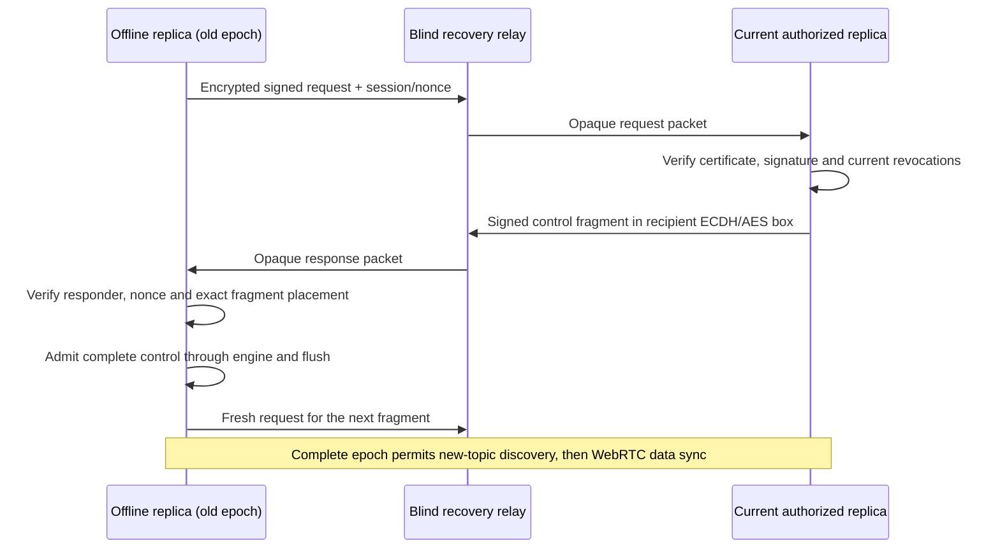

# Discovery recovery across project key epochs

Status: included in v0.3.0; public v0.2.0 predates these APIs.
Recovery is opt-in. Automatic rebinding of normal discovery also runs without it.
The C++ ABI, data events and ordinary discovery wire format are unchanged.

## Enable recovery

Supply independent providers on participating recovery peers:

```ts
import { P2PWebRTC } from 'sovereign-local-core';
import { NostrDiscovery } from 'sovereign-local-core/nostr';

const sync = new P2PWebRTC(client, {
  discovery: new NostrDiscovery({
    routing: { bucketCount: 64, sampleBuckets: 3, rotationIntervalMs: 3000 },
  }),
  recovery: {
    discovery: new NostrDiscovery({ routing: { bucketCount: 64, sampleBuckets: 3 } }),
    intervalMs: 30000,
    responseTimeoutMs: 15000,
    transferTimeoutMs: 300000,
    onRecovered: keyId => console.log('Discovery epoch ready', keyId),
  },
});
await sync.start();
console.log(sync.recoveryStats);
// During application/component cleanup:
sync.stop();
```

Providers cannot be the same instance: rebinding the main subscription must not
stop recovery. They can share relay URLs. Optional [routed recovery](RECOVERY_ROUTING.md)
samples probe buckets and addresses selected transfers to inboxes; plain providers
retain the broadcast mode. Recovery and normal discovery layouts must each match
among their own participants. `ReadDomainsClient.connect(domain => options)` accepts these settings
independently per opened domain; never reuse provider instances across domains.

Custom cores must implement `IDiscoveryRecoveryCore`. The client/Worker methods are
`getDiscoveryRecoveryInfo`, `createDiscoveryRecoveryRequest`,
`handleDiscoveryRecoveryRequest`, `acceptDiscoveryRecoveryResponse` and
`cancelDiscoveryRecovery`. Private keys/handles never cross RPC. `DiscoveryRecovery`
can also run independently of WebRTC.

Routed recovery additionally uses `createRoutedDiscoveryRecoveryRequest` and
`handleRoutedDiscoveryRecoveryRequest`. The info response includes an `instanceId`;
verified progress/replies include the next destination. Missing routed capabilities
fail explicitly without switching to broadcast. Signed probes receive small offers;
only a selected responder allocates a cursor. See [wire/lifecycle contracts](RECOVERY_ROUTING.md).

## Stable control-only rendezvous

Normal SDP/ICE discovery rotates its key and topic. Recovery derives a separate
stable topic/AES key from the genesis key using tagged HKDF and pinned project/root
identity. Knowing that locator is routing ability, never current membership.



Any current authorized Member can supply its authenticated governance controls;
the Root Admin need not be online. Original root/Admin signatures authorize the
controls. The responder issues no new role or grant. Even a genuinely signed
application event is rejected by recovery. No SDP, ICE, snapshots, blob bytes or
application events travel here; governance descriptors/recipients remain metadata.

Requests have wallet signatures, verified certificate chains, fresh sessions and
per-request nonces, with 60s lifetime and 30s clock-skew tolerance. The responder
checks every request against its current revocations, including delegated
descendants. An old-key holder cannot impersonate another wallet.

Responses add a fresh ephemeral P-256 ECDH sender key, HKDF and AES-GCM addressed
to the requester's wallet. The derivation/AAD bind the channel, recipient and
ephemeral point. Inside that box, the responder signs its certificate, epoch,
session, exact request nonce, cursor, counts, offsets and binary fragment. An outer
recovery AES layer hides that box from the relay. Old-key holders can know the
locator but cannot decrypt another wallet's reply. This SDK protocol uses
[Web Crypto ECDH/HKDF/AES-GCM](https://www.w3.org/TR/2017/REC-WebCryptoAPI-20170126/),
not NIP-04/NIP-44 encryption. The optional relay envelope uses
[Nostr NIP-01](https://github.com/nostr-protocol/nips/blob/master/01.md).

The first valid response pins the responder/cursor. Other responders and earlier
session/request replies cannot advance the transfer. Verified nonces remain until
expiry; saturation fails closed without evicting unexpired evidence. Separate
request/response replay windows do not share normal discovery's nonce budget.
The outer packet identifies request/response kind. Relays still see connecting
clients' IPs, timing, sizes and the stable opaque topic; no anonymity is claimed.

## Durability and rebinding

The source uses its authenticated governance cache and sends one bounded binary
record in 16 KiB fragments. Subsequent requests follow verified fragments; after
a complete record, the next request follows ordinary signature, certificate,
policy/Merkle checks and durable OPFS flush. Partial records never enter the log.
There is no alternate storage writer or reducer.

Serving cursors pin the governance revision and current epoch. Governance changes
invalidate them. Timeouts restart from the receiver's durable log; already received
controls are authenticated duplicates. Interrupted record assemblies are discarded.
Flush failure faults the core and requires reopen, as in ordinary synchronization.

A complete requester advertises its known key ID. A responder at the same epoch
sends a short terminal response without replaying controls. Pending-page replicas
advertise no complete epoch. Completion requires a matching materialized current
key, possession of that key, no pending epoch and membership of both parties under
learned revocations. Stale responders cannot downgrade a locally known newer
epoch. Dependent data remains blocked while epoch pages are incomplete.

`P2PWebRTC` observes durable governance commits and checks its epoch on maintenance.
It rebinds legacy/routed subscriptions, drops old-binding queued packets and checks
that freshly sealed packets publish on their correct topic. Known revoked edges
close. Already online authorized DataChannels survive and carry ordinary sync.
Incomplete epochs pause normal discovery while authorized edges and the independent
recovery path can complete controls. Revoked identities cannot use new discovery
keys. No recovery option is needed for the automatic rebinding itself.

## Finite bounds and availability

| Resource | Bound/default |
| --- | --- |
| Encrypted packet / plaintext fragment | 32 KiB / 16 KiB maximum |
| Outgoing transfer / record assembly | One per core / one record up to 1 MiB |
| Serving cursors | 8 per core, lazy 60s idle expiry |
| Retained encoded serving records | One bounded record per active cursor |
| Controls per transfer | 65,536 maximum |
| Incoming adapter queue | 32 packets, size checked before copying |
| Request/response replay windows | 4,096 unexpired nonces each |
| Idle poll / response wait / transfer deadline | 30s / 15s / 300s defaults |

Intervals must be safe integers between 100ms and the platform timer limit. All
core state is serialized in the Worker. Stop cancels timers/subscriptions, requests
and buffers; stale callbacks cannot publish into a replacement session. Governance
cache size/replay/checkpoints still grow with history. Recovery does not compact
the log or remove keyring, native history, browser quota or memory boundaries.

The plain-provider stable locator is a **broadcast** channel with an additional provider
socket/subscription per relay. All enabled peers receive encrypted requests; several
responders may allocate bounded cursors before one is selected. It is opt-in and
is not a scalable replacement for routed discovery. [Routed recovery](RECOVERY_ROUTING.md)
now samples probes, targets offers and sends selected fragments between inboxes,
without speculative serving cursors. Large installations still need adaptive
layouts, publication/rate management and measured relay budgets. Repeated timeouts/floods can bind finite cursor or nonce budgets until
expiry. Cryptographic authorization does not guarantee availability under flooding.

Recovery requires a reachable current replica with the controls and compatible
recovery enabled. Ephemeral public relays provide no durable mailbox guarantee;
requests retry. If current replicas are all offline, updated authenticated bootstrap
or another authorized transport remains necessary. STUN/TURN and NAT constraints
still apply after recovery.

An unseen revocation cannot be inferred locally. Two stale peers can communicate
at their last known epoch; completion is relative to observed signed history,
not Byzantine consensus or proof of global freshness. Stable topic linkage remains.
Later compromise of a recipient wallet can decrypt recorded addressed replies;
this is not forward secrecy against wallet compromise. Revocation cannot erase
old plaintext/keys. Authorized recipients receive governance metadata.

## Verification scope

Unit tests cover fragmented epochs from a Member with the root closed, data-event
rejection, outsiders, revoked descendants, replay/expiry, signature/ciphertext
tampering, caller-buffer mutation, changed revisions, finite cursors, partial
recovery/reopen and startup/oversize cleanup.

Chrome tests use real Workers, OPFS, local blind Nostr relay adapters and native
WebRTC. They cover cold and manifest-first partial replicas, root-offline recovery,
ordinary live data and lazy file pulls afterwards, revoked old-wallet exclusion,
OPFS reopen and subscription cleanup. A live test verifies legacy-topic rebinding,
retaining the exact authorized DataChannel while removing a revoked edge.

These few-wallet/local-ICE correctness tests are not public-relay uptime, WAN/NAT,
10k-member throughput or peak-RAM benchmarks. See [paged epochs](PAGED_EPOCHS.md),
[routing](DISCOVERY_ROUTING.md) and [scalability](SCALABILITY.md).
